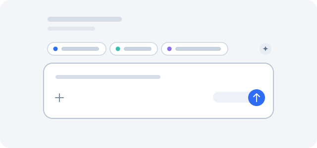

Prompt Pilot puts a short row of next-step chips directly above the message box. Each chip is one
click away from the thing you would most likely do next, and the row disappears the moment you
start writing — it suggests, it never competes with your draft.

The row holds at most four chips. Repository and session signals come first, because they name a
concrete object; model-written prompts fill whatever room is left.

## What fills the row

| Chip | Appears when | Clicking it |
| --- | --- | --- |
| **Resume** | The last turn ended before finishing — the app restarted, the token limit was hit, a non-user abort happened, an error occurred, or the turn was blocked | Fills the composer with a prompt that continues from the exact stopping point |
| **Open PR #N diff** | The current branch has an open pull request according to the GitHub CLI | Opens that pull request's diff in a new tab in the right sidebar |
| **Review changes** | The worktree has uncommitted files | Fills the composer with a review request naming the change count |
| **Model prompts** | While the row is on screen and a model route is configured | Fill the composer with a model-written prompt |

A chip that fills the message box shows a prompt glyph; one that opens a panel shows a small
outward arrow. The action is also spelled out in the tooltip and in the accessible name, so it is
legible before the click rather than after.

**Resume deliberately stays quiet** after you press Stop or fork a session: those are instructions,
not accidents, and offering to undo them would argue with you.

## The pull request panel

The **Open PR #N diff** chip opens a real tab in the right sidebar: the PR number, title, added and
removed line counts, changed file count, and a link to open it on GitHub, above the unified diff
grouped by file. The panel is read-only by design — it shows you what you are about to review; the
agent does the reviewing.

If the branch's pull request changed since the tab was opened, the panel says so and offers the
current one instead of a retry that could never succeed.

## Keyboard and accessibility

Every chip is an ordinary button: <kbd>Tab</kbd> reaches it and <kbd>Enter</kbd> or
<kbd>Space</kbd> picks it. Clicking one does not steal the caret — the press is intercepted, so a
chip can fill the draft without pulling focus out of the message box.

The row carries a group label and a busy state, loading and failure are announced through a status
region, and the failure state offers a real Retry. The refresh control keeps its label and stops
spinning when the system asks for reduced motion.

## Limits

- Repository signals run `git` and the GitHub CLI locally on the Host. The model-written prompts
  send a compact digest of the last few exchanges, plus branch and worktree facts, to the model
  route your profile already uses. The model is only asked while the row is actually on screen and
  is not asked while you are typing.
- Pull requests are found through the GitHub CLI (`gh`). Sessions outside a git repository, or
  without `gh` installed and authenticated, simply show fewer chips — the row never blocks.
- The diff panel needs `gh pr diff`, so private repositories must have the CLI authenticated for
  the same user the app runs as.
- Diffs longer than a few thousand lines are truncated with a note; use the GitHub link for the
  whole thing.
